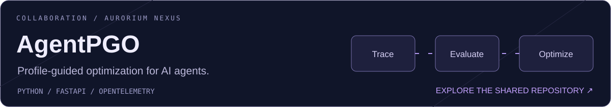
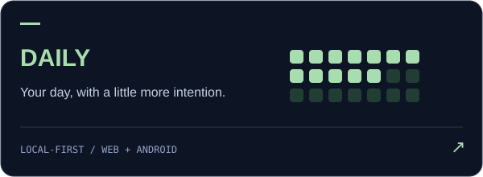
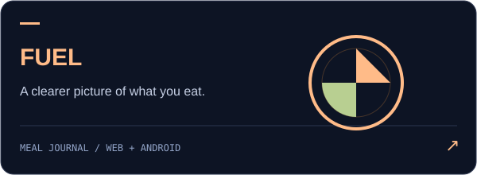
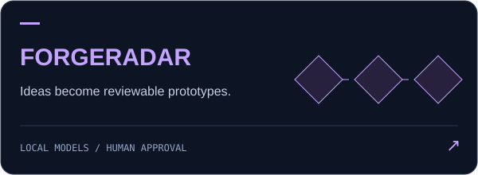
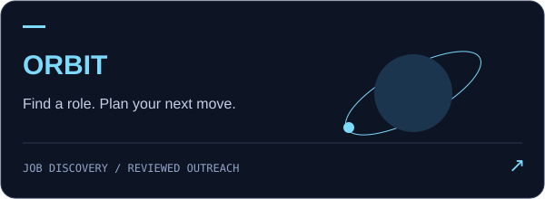
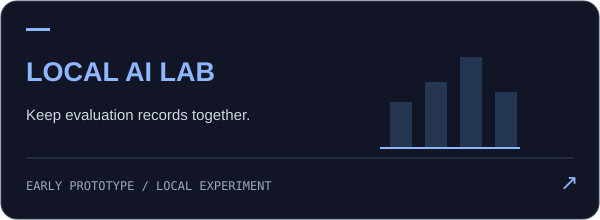
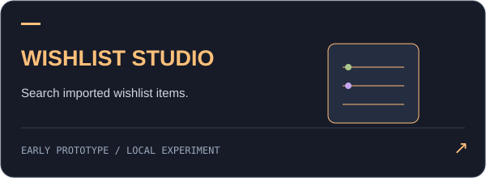

  <a href="https://ayush-kumar-jha-v2.onrender.com/"><b>PORTFOLIO ↗</b></a> &nbsp;&nbsp; / &nbsp;&nbsp;
  <a href="https://github.com/AyushKJha/profile-2.0/blob/main/CV.pdf"><b>CV ↗</b></a> &nbsp;&nbsp; / &nbsp;&nbsp;
  <a href="https://linkedin.com/in/ayush-kumarjha-2683a832a"><b>LINKEDIN ↗</b></a> &nbsp;&nbsp; / &nbsp;&nbsp;
  <a href="mailto:ayushjha.kviitkgp@gmail.com"><b>LET'S TALK ↗</b></a>

 

I'm **Ayush**, an Electronics & Communication Engineering student at **SMVIT, Bengaluru**. I build tools for everyday use, experiment with AI-agent systems, and work with hardware when the idea calls for it.

My work spans **web & Android**, **agent infrastructure**, and **embedded systems**. Here are a few things you can try, inspect, or explore.

 

## 01 / Building together

**A collaboration with [Aurorium Nexus](https://github.com/Auro-rium).**

Profile-guided optimization for AI agents: collect traces, understand cost and latency, evaluate runs, and compare optimization candidates.

`Python` `FastAPI` `OpenTelemetry` `TypeScript SDK`

[Shared repository](https://github.com/Auro-rium/agent-PGO) · [My related backend work](https://github.com/AyushKJha/PGO_work)

 

## 02 / Selected builds

<table>
<tr>
<td width="50%" valign="top">

<b>A little better, every day.</b>

A routine journal with custom habits, encrypted local workspaces, weekly reports, and an Android app.

<code>JavaScript</code> <code>IndexedDB</code> <code>Android</code>

<a href="https://daily-routine-journal.onrender.com"><b>Try Daily ↗</b></a> · <a href="https://github.com/AyushKJha/Daily_Routine_Tracker/releases/tag/android-v1.1.0">APK</a> · <a href="https://github.com/AyushKJha/Daily_Routine_Tracker">Code</a>

</td>
<td width="50%" valign="top">

<b>Your food, in focus.</b>

A meal journal for photos, food labels, editable portions, and nutrition history across web and Android.

<code>Next.js</code> <code>Supabase</code> <code>Expo</code>

<a href="https://fuel-journal.vercel.app"><b>Try Fuel ↗</b></a> · <a href="https://github.com/AyushKJha/fuel-app#android-download">APK</a> · <a href="https://github.com/AyushKJha/fuel-app">Code</a>

</td>
</tr>
<tr>
<td width="50%" valign="top">

<b>From signal to software.</b>

A local-model workshop that turns community ideas into proposals and bounded prototypes after approval.

<code>Node.js</code> <code>Ollama</code> <code>SQLite</code>

<a href="https://github.com/AyushKJha/ForgeRadar"><b>Explore the pipeline ↗</b></a> Local-first experiment

</td>
<td width="50%" valign="top">

<b>A workspace for your next move.</b>

Job discovery, application materials, and Gmail outreach with a review step before messages are sent.

<code>Node.js</code> <code>OAuth</code> <code>Ollama</code>

<a href="https://github.com/AyushKJha/orbit-job-agent"><b>Explore Orbit ↗</b></a> · <a href="https://orbit-job-agent.onrender.com">Preview</a> Preview requires an invitation

</td>
</tr>
<tr>
<td width="50%" valign="top">
A local record keeper for evaluation datasets, model comparisons, and reports.

<a href="https://github.com/AyushKJha/Local-AI-Evaluation-Workbench">Explore Local AI ↗</a> · <a href="https://github.com/AyushKJha/Local-AI-Evaluation-Workbench/blob/main/docs/USER_GUIDE.pdf">User guide</a>
</td>
<td width="50%" valign="top">
An offline prototype for importing, searching, and filtering wishlist items.

<a href="https://github.com/AyushKJha/Amazon-Wishlist-filter">Explore Wishlist Studio ↗</a> · <a href="https://github.com/AyushKJha/Amazon-Wishlist-filter/blob/main/docs/USER_GUIDE.pdf">User guide</a>
</td>
</tr>
</table>

 

## 03 / Beyond the browser

| Project | What you'll find |
| :--- | :--- |
| **[ESP32 Lab ↗](https://github.com/AyushKJha/ESP32_Microcontroller_Car)** | Bluetooth motor control, distance sensing, and independent Arduino sketches from a college hardware lab. |
| **[Security Studies ↗](https://github.com/AyushKJha/Cybersecurity_Battlefield-)** | Four educational reports on network defence, application assessment, system hardening, and data protection. |
| **[Chhath Mahaparv ↗](https://github.com/AyushKJha/chatt-mahaparv)** | A music experience with Bhojpuri copy, Madhubani-inspired visuals, and local audio playback. |

 

## 04 / My toolkit

**Interfaces** &nbsp; JavaScript · TypeScript · React · Next.js · HTML · CSS · Expo 
**Backend & data** &nbsp; Python · Node.js · FastAPI · SQL · Supabase · IndexedDB 
**Systems & experiments** &nbsp; Git · ESP32 · Arduino · OpenCV · Agent workflows

<b>A little more about me</b>

- **B.E. Electronics & Communication**, SMVIT — expected 2028.
- [Cloud Computing and Cybersecurity certificates](https://github.com/AyushKJha/Certificates).
- Technical community work at **TechHub, SMVIT**, including a Blue Team introduction for freshers and presenting at Starpitch 2.0.

 

---

**Have a project worth building together?** 
[Send me a note ↗](mailto:ayushjha.kviitkgp@gmail.com) · [See my portfolio ↗](https://ayush-kumar-jha-v2.onrender.com/)
